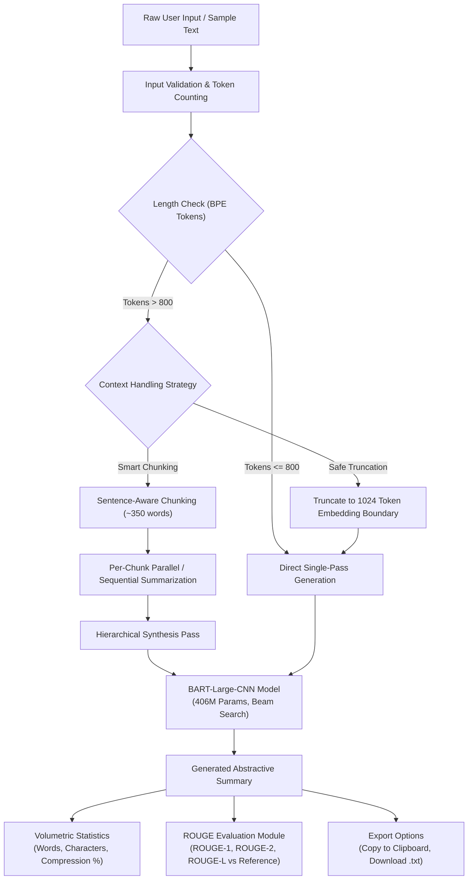

# Neural Text Summarization Platform

[](https://www.python.org/)
[](https://pytorch.org/)
[](https://huggingface.co/transformers/)
[](https://streamlit.io/)
[](https://huggingface.co/facebook/bart-large-cnn)
[]()
[](LICENSE)

An end-to-end, production-ready neural text summarization web application powered by **Meta AI's BART (Bidirectional and Auto-Regressive Transformers)** model. Built with **Streamlit**, **PyTorch**, and **Hugging Face Transformers**, this platform transforms long-form articles, scientific abstracts, and news documents into concise, grammatically fluent abstractive summaries with quantitative ROUGE evaluation.

---

## Architecture Overview



---

## Model Architecture & Technical Context

* **Base Model**: [`facebook/bart-large-cnn`](https://huggingface.co/facebook/bart-large-cnn)
* **Architecture**: Sequence-to-Sequence (Seq2Seq) Transformer featuring a bidirectional encoder (similar to BERT) coupled with an autoregressive left-to-right decoder (similar to GPT).
* **Parameters**: ~406 Million parameters across 12 encoder layers, 12 decoder layers, and 16 attention heads.
* **Corpus / Pretraining**: Pretrained on a 160GB English corpus using denoising objectives (token masking, token deletion, text infilling, sentence permutation) and subsequently fine-tuned on the **CNN / DailyMail** news summarization dataset.
* **Inference Nature**: **This project executes zero-shot / pretrained inference.** The model weights are not trained from scratch or fine-tuned within this application. All generations use deterministic beam search decoding with beam width $k=4$, length penalty $\alpha=2.0$, and n-gram repeat suppression ($n=3$).

---

## Key Features

### 1. Abstractive Neural Summarization
- Produces novel paraphrased summaries rather than simple extractive sentence selection.
- **Three Calibrated Length Presets**:
  - **Short**: 30–60 tokens (concise 1–2 sentence executive takeaway).
  - **Medium**: 60–130 tokens (standard balanced summary).
  - **Long**: 130–250 tokens (comprehensive multi-paragraph briefing).
- **Custom Mode**: Fine-grained sliders for minimum/maximum token bounds, beam search width, and length penalty.

### 2. Context Limit Safeguards (Smart Chunking & Truncation)
- `facebook/bart-large-cnn` has a hard context limit of **1,024 tokens**.
- Standard pipelines crash or truncate arbitrarily on long inputs.
- This application provides:
  - **Smart Chunking**: Splits large documents into sentence-aware segments (~350 words), summarizes each chunk, and synthesizes the intermediate outputs into a final cohesive summary.
  - **Safe Truncation**: Gracefully caps input to 1,024 tokens with informative status warnings.

### 3. Quantitative Text Statistics
- **Input Word Count** and **Summary Word Count**.
- **Input Character Count** (with and without whitespace).
- **Compression Ratio**: Expressed as $(\text{Summary Words} / \text{Input Words}) \times 100\%$.
  > *Note: Compression ratio reflects volumetric text reduction, not summary quality or factual fidelity.*

### 4. Ground-Truth Evaluation (ROUGE Metrics)
- Built-in evaluation module supporting:
  - **ROUGE-1**: Unigram overlap (vocabulary coverage).
  - **ROUGE-2**: Bigram overlap (phrase fluency and coherence).
  - **ROUGE-L**: Longest Common Subsequence (sentence structure and word ordering).
- Calculates exact **Precision**, **Recall**, and **F1-Score** against a user-provided human reference summary.

### 5. Developer & User Usability
- **Curated Domain Samples**: One-click preloaded articles (AI & Healthcare, Quantum Computing & Cryptography, Renewable Smart Grids) with accompanying reference summaries.
- **Copy to Clipboard**: Instant raw-text copy popover.
- **Download Summary**: Export generated summary directly as a `.txt` file.
- **Clear Text**: One-click input reset.
- **Subword BPE Token Counter**: Real-time token estimator showing context window utilization.

---

## Project Structure

```text
text-summarization-app/
├── app.py                     # Main Streamlit web application & UI presentation layer
├── src/
│   ├── __init__.py
│   ├── summarizer.py          # BART model loading, caching, presets & generation
│   ├── utils.py               # Text statistics, parameter validation & sentence chunking
│   ├── evaluator.py           # Pure-Python ROUGE-1, ROUGE-2, and ROUGE-L metric engine
│   └── sample_data.py         # Curated domain articles with reference summaries
├── tests/
│   ├── __init__.py
│   ├── test_utils.py          # Unit tests for text metrics, validation & chunking
│   ├── test_evaluator.py      # Unit tests for ROUGE precision, recall & F1 math
│   └── test_summarizer.py     # Unit tests for model configuration & preset bounds
├── .streamlit/
│   └── config.toml            # Application theme and production flags
├── .gitignore                 # Exclusion rules for venvs, model caches, and keys
├── requirements.txt           # Pinned dependencies for Python 3.12 compatibility
├── LICENSE                    # MIT License
└── README.md                  # Comprehensive technical documentation
```

---

## Installation & Setup

### Prerequisites
- Python **3.12**
- Git

### 1. Clone the Repository
```bash
git clone https://github.com/antonsoo/text-summarization-app.git
cd text-summarization-app
```

### 2. Create and Activate a Virtual Environment
```bash
# Windows
python -m venv venv
.\venv\Scripts\activate

# macOS / Linux
python3 -m venv venv
source venv/bin/activate
```

### 3. Install Dependencies
```bash
pip install -r requirements.txt
```

> **Dependency Note**: `transformers` is pinned to `4.57.1` because Transformers 5.x refactored and deprecated legacy summarization pipelines.

---

## Execution

To launch the Streamlit application:

```bash
python -m streamlit run app.py
```

Once started, the application will be accessible in your web browser at:
```
http://localhost:8501
```

---

## Running the Unit Test Suite

The test suite is written using Python's standard library `unittest` framework and requires no external test runner:

```bash
python -m unittest discover tests
```

Output:
```text
......................
----------------------------------------------------------------------
Ran 22 tests in 0.002s

OK
```

The test suite validates:
- Standard and edge-case word and character counting (extra whitespace, tabs, empty strings).
- Compression ratio calculation and zero-division protection.
- Length parameter validation (enforcing $5 \le \text{min} \le \text{max} \le 1024$).
- Sentence-aware text chunking and sentence boundary preservation.
- Mathematical precision, recall, and F1 calculations for ROUGE-1, ROUGE-2, and ROUGE-L.
- Preset configuration integrity.

---

## Limitations & Engineering Considerations

1. **Inference Latency on CPU**: BART-Large contains ~406M parameters (~1.6GB in FP32). While the application auto-detects CUDA GPUs when available, running on standard CPU hardware takes 4–8 seconds per generation.
2. **Context Window Constraint**: BART's maximum positional embedding size is 1,024 tokens. For documents significantly exceeding this limit, the application utilizes hierarchical chunk synthesis or truncation.
3. **Abstractive Hallucination**: As with all autoregressive sequence-to-sequence language models, BART can occasionally generate statements not strictly grounded in the source passage ("hallucinations"). For critical applications, human review remains essential.
4. **Domain Shift**: BART-Large-CNN was fine-tuned on news journalism. Complex legal contracts, biochemical literature, or non-English texts may experience reduced fidelity compared to news articles.

---

## Adding Application Screenshots

To display screenshots of your running application on GitHub:
1. Create an `assets/` directory in the repository root:
   ```bash
   mkdir assets
   ```
2. Take a screenshot of the running Streamlit interface and save it as `assets/app_demo.png`.
3. Add the markdown link below:
   ```markdown
   
   ```

---

## Attribution & Acknowledgements

- **Original Project**: Based on the foundation repository by [Anton Soloviev](https://github.com/antonsoo/text-summarization-app).
- **Model**: `facebook/bart-large-cnn` by [Meta AI Research](https://arxiv.org/abs/1910.13461) (*Lewis et al., 2019: BART: Denoising Sequence-to-Sequence Pre-training for Natural Language Generation, Translation, and Comprehension*).
- **Libraries**: [Hugging Face Transformers](https://github.com/huggingface/transformers) and [Streamlit](https://streamlit.io).

---

## License

This project is licensed under the MIT License - see the [LICENSE](LICENSE) file for details.
